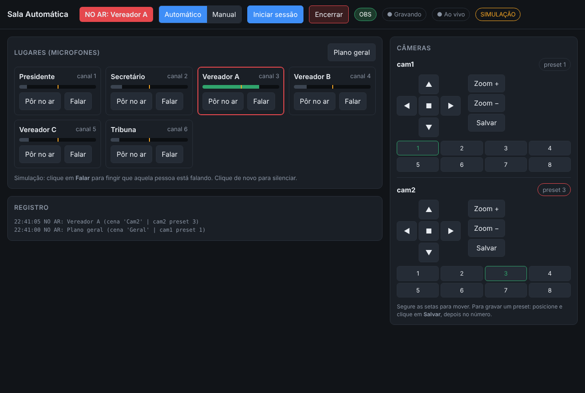

# Sala Automática v0.1

Diretor automático para salas com câmeras PTZ: **quem fala, aparece**.
Lê o nível de cada microfone, move a câmera certa para o preset daquela
cadeira e troca a cena no OBS, sem nunca mostrar câmera se mexendo no ar.



## O que faz

- **Modo automático:** detecta quem está falando e leva a pessoa ao ar.
- **Nunca mostra movimento:** move uma câmera que está fora do ar, espera parar e só então corta.
- **Silêncio:** volta para o plano geral depois de alguns segundos sem fala.
- **Modo manual:** o operador clica no lugar e o automático para de mexer.
- **Painel web:** joystick PTZ, zoom, presets (chamar/salvar), iniciar/encerrar sessão (grava + transmite pelo OBS). Abre em qualquer navegador da rede, até no celular.
- **Simulação:** testa tudo sem câmera, sem microfone e sem OBS.

## 1. Testar agora (simulação, 5 minutos)

Precisa do Python 3.10+ ([python.org](https://www.python.org/downloads/); no Windows marque *Add Python to PATH*).

**Windows, jeito mais fácil:** dê dois cliques em `iniciar_simulacao.bat`. Na primeira vez ele instala tudo sozinho e depois abre o painel no navegador.

**Pelo terminal:**

```bash
cd salaauto
pip install -r requirements.txt
python main.py --sim
```

Abra **http://localhost:8080** e clique em **Falar** em um dos lugares.
Em ~2 s a etiqueta vermelha "NO AR" muda para essa pessoa. Pare de falar e ela volta ao plano geral.

## 2. Ligar no equipamento real

### Rede
Ligue câmeras e PC no mesmo switch (PoE se as câmeras forem PoE). Dê IP fixo às câmeras, ex.: `192.168.1.101` e `.102`.

### Câmeras
1. No navegador, entre na página da câmera (IP dela) e confirme:
   - **RTSP** ligado (o endereço costuma ser algo como `rtsp://IP:554/1` — veja o manual).
   - **VISCA over IP** ligado e a **porta**.
2. No `config.yaml`, preencha `ip`, `porta` e `protocolo`:

| Protocolo | Porta típica | Marcas comuns |
|---|---|---|
| `sony_udp` | 52381 | Sony, Avonic, muitas "Sony compatible" |
| `raw_udp` | 1259 | PTZOptics |
| `raw_tcp` | 5678 | PTZOptics, Lumens, Minrray |

Não funcionou um? Tente o outro. O painel mostra o erro em vermelho embaixo da câmera.

### OBS Studio
1. **Ferramentas → Configurações do servidor WebSocket → Ativar**, defina uma senha e coloque a mesma em `obs.senha`.
2. Crie as cenas com **os mesmos nomes** do `config.yaml`: `Geral`, `Cam1`, `Cam2`.
3. Em cada cena, adicione a fonte **Fonte de mídia** (desmarque "Arquivo local") com o RTSP da câmera. `Geral` e `Cam1` usam a cam1; `Cam2` usa a cam2.
4. Configure a transmissão (YouTube) em **Configurações → Transmissão**.

### Áudio
1. Use uma interface/mesa que entregue **um canal por microfone** no PC (ex.: Behringer UMC404HD, mesas digitais com USB multicanal).
2. Rode `python main.py --listar-audio` e coloque o número do dispositivo em `audio.dispositivo` e a quantidade em `audio.canais`.
3. Em `lugares`, ligue cada pessoa ao seu canal.

### Gravar os presets
1. Mude `simulacao: false` e rode `python main.py`.
2. No painel, clique em **Manual**. Use o joystick e o zoom para enquadrar cada cadeira.
3. Clique **Salvar** e depois no **número** do preset. Repita para todos os lugares do `config.yaml`.
4. Volte para **Automático**.

## 3. Ajuste fino (`regras` no config.yaml)

| Regra | Padrão | Quando mexer |
|---|---|---|
| `limiar_db` | -40 | Câmera troca com tosse/barulho → suba para -35. Não detecta voz baixa → desça para -45. A linha amarela na barra do painel mostra o limiar. |
| `tempo_minimo_fala_s` | 1.5 | "Sim", "não" curtos trocando a câmera → aumente |
| `tempo_minimo_plano_s` | 4 | Cortes rápidos demais → aumente |
| `silencio_para_geral_s` | 6 | Volta ao geral cedo/tarde demais |
| `tempo_assentamento_s` | 1.2 | Ainda aparece a câmera terminando o movimento → aumente |

**Dica:** cadastre 2 planos por lugar (um em cada câmera). Assim sempre existe uma câmera livre para se mover enquanto a outra está no ar.

## Estrutura

```
main.py              inicia tudo
config.yaml          sua sala (câmeras, OBS, áudio, lugares)
salaauto/visca.py    comandos PTZ (VISCA over IP)
salaauto/obs.py      cenas, gravação e transmissão no OBS
salaauto/audio.py    nível dos microfones (real e simulado)
salaauto/diretor.py  a lógica do diretor automático
salaauto/servidor.py API e painel
web/index.html       painel do operador
```

## Limitações desta versão

- Testado em simulação e com câmera VISCA emulada; ainda **não** testado com câmera física.
- O vídeo é capturado pelo OBS (o programa só comanda câmeras e cenas).
- Sem login no painel: use só em rede interna.
- Um microfone aberto o tempo todo (ex.: ambiente) atrapalha. Deixe-o fora de `lugares`.

## Próximos passos sugeridos

- Iniciar junto com o Windows (serviço) e abrir o OBS automaticamente.
- Senha no painel.
- Leitura de nível direto de mesas digitais pela rede (sem placa multicanal).
- Rastreamento por vídeo (detecção de rosto) para a tribuna.
